<picture>
  <source media="(prefers-color-scheme: dark)" srcset="docs/logo/kense-mark-dark.png">
  
</picture>

# The K programming language

English · [简体中文](README.zh-CN.md)

[Architecture](#core-architecture) · [Modules](#module-architecture) ·
[Build](#build-from-source) · [Run a program](#run-a-program) ·
[WebAssembly](#build-a-webassembly-executable) ·
[Roadmap](docs/roadmap.md)

K is a memory-safe systems programming language with checked reference
lifetimes and explicit control over storage. It stores growable values on
address-stable data stacks and reclaims their storage at scope exit. K
uses a C backend to build native and WASI WebAssembly executables. Its
command-line tool is `k`, and source files use `.k`.

The long-term goal is to make K a first choice for operating system
components, cloud services, and AI infrastructure. The first production target
is a cloud inference gateway. A freestanding boot target and a Cordis
profile for Node.js compatibility are on the roadmap.

## Core architecture

[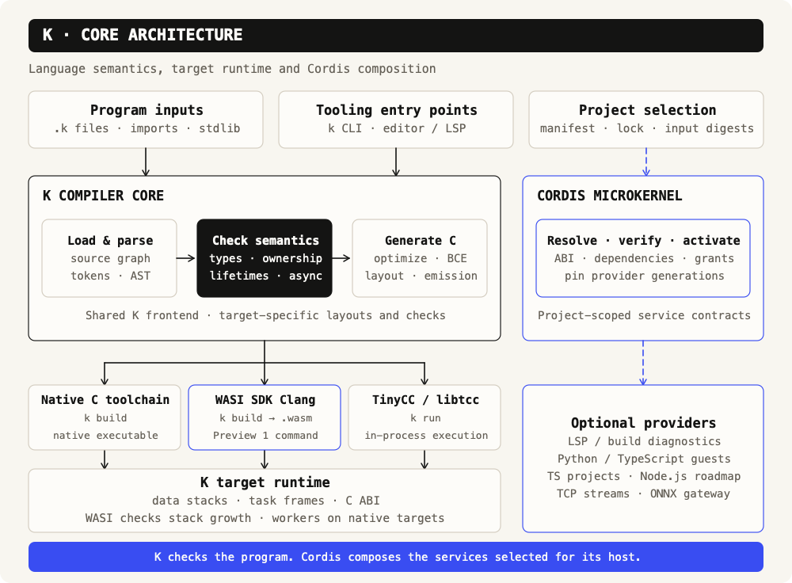](docs/diagrams/svg/core-architecture.svg)

The compiler owns K's syntax, types, lifetimes, and checked program representation.
Native builds, WASI command builds, and TinyCC execution share the checker and
use C generated for the selected target. The K runtime supplies data-stack storage,
task frames, and the C ABI. Native builds also support worker threads and typed queues.

Cordis is K's primary design principle. Each host selects services through versioned
interfaces. A checked lock ties a selected graph to provider versions and tracked
inputs. The host can link providers statically or load them dynamically according to
its supported contracts. CPython and QuickJS/TypeScript adapters, the TypeScript and
future Node.js compatibility profiles, and the ONNX inference gateway are optional
Cordis components with their own build targets and verified graphs. They are not
dependencies of the K compiler or target runtime. [Architecture notes](docs/architecture.md) ·
[Cordis design](docs/design/cordis_microkernel.md)

## Dependencies and context map

[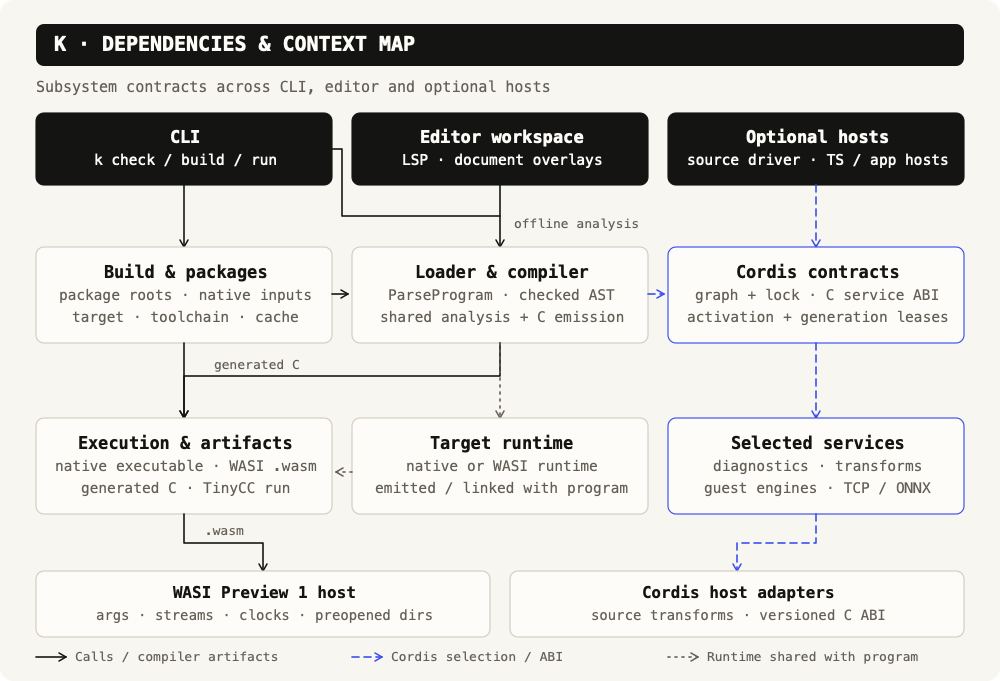](docs/diagrams/svg/context-map.svg)

Solid arrows show calls or compiler artifacts. Dashed indigo arrows show Cordis
selection and service interfaces. Dotted gray arrows show runtime support shared
with the generated program. The editor overlays unsaved documents and resolves
packages offline. The optional source driver feeds generated K through the normal
compiler entry point. The standalone TypeScript runner uses its own Cordis graph.
A WASI host runs WebAssembly command modules and grants access to resources
such as preopened directories.
[Subsystem boundaries](docs/architecture.md#domain-boundaries-in-the-code)

## Module architecture

Select any diagram to open its editable SVG source.

### Compiler front end

[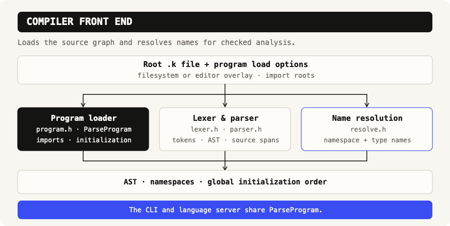](docs/diagrams/svg/compiler-front-end.svg)

`program.h` loads imports and determines global initialization order. The lexer
and parser retain source spans. `resolve.h` resolves type names within the
program's namespaces. The CLI and language server share `ParseProgram`.
[Front-end implementation](docs/implementation.md#2-front-end)

### Semantic analysis

[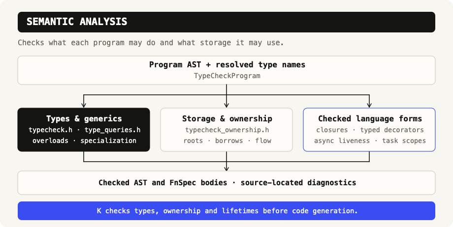](docs/diagrams/svg/semantic-analysis.svg)

The checker specializes generic functions, validates reference roots and
ownership transfers, and checks closure captures, typed decorators, and values
that survive suspension. Checked function bodies carry the facts that subsequent
passes use. [Type checker](docs/implementation.md#3-the-typechecker) ·
[Async functions and decorators](docs/design/async_and_decorators.md)

### Optimization and C backend

[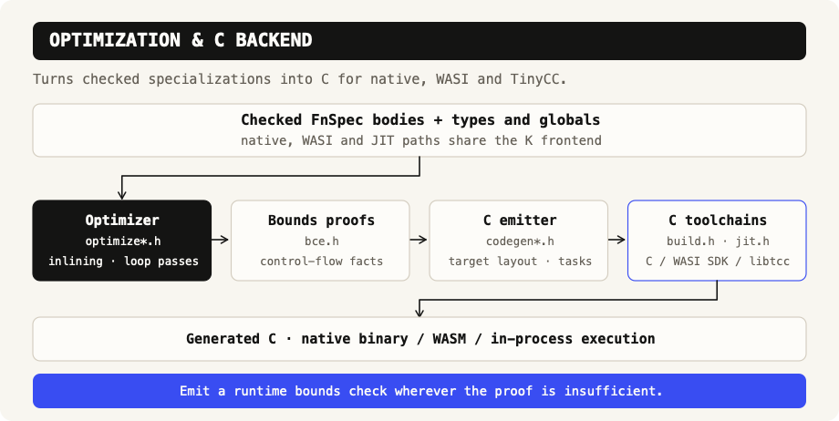](docs/diagrams/svg/c-backend.svg)

Optimization operates on checked specializations. Bounds-check elimination uses
control-flow and aliasing facts. The emitter produces C layouts, calls, and
task state machines, retaining runtime checks where the proof is insufficient.
[Compiler pipeline](docs/implementation.md#1-pipeline) ·
[Bounds-check elimination](docs/implementation.md#5-bounds-check-elimination)

### WebAssembly target

[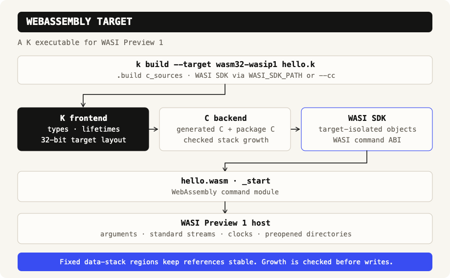](docs/diagrams/svg/webassembly-target.svg)

`k build --target wasm32-wasip1` builds a `.wasm` command module with the K
runtime linked in. Its fixed data-stack regions remain address-stable in linear
memory. The compiler and runtime check available space before stack writes.
The target supports cooperative `async` tasks, standard streams, arguments,
clocks, and file access through preopened directories. Plain C sources declared
by package `.build` files compile with the same WASI toolchain and link into the
module; package caches are separated by target and toolchain. Worker threads,
dynamic `extern` libraries, CMake and builtin native packages, browser integration,
and component-model hosts remain roadmap work.
[WebAssembly design](docs/design/wasm.md#wasi-command-target) ·
[WASI integration tests](docs/testing.md#wasi-command-target)

### Target runtime

[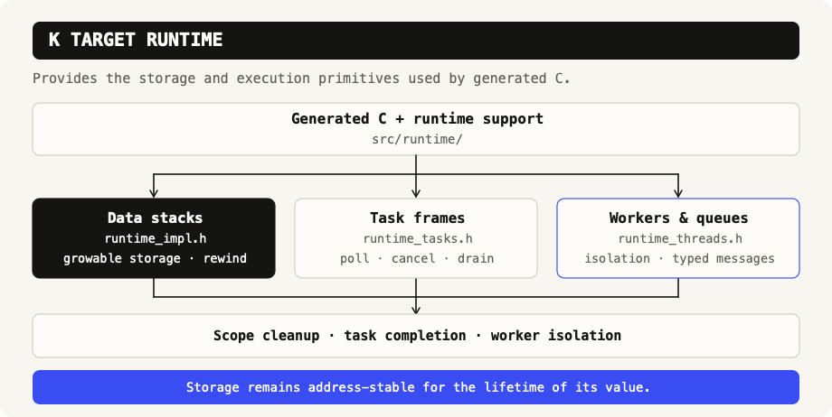](docs/diagrams/svg/target-runtime.svg)

Growable local values use address-stable data stacks that can rewind at scope exit.
Task frames preserve the state needed by `await` and run cleanup on cancellation.
Native builds support isolated workers exchanging messages through typed queues.
[Runtime implementation](docs/implementation.md#7-the-runtime) ·
[Lexical task scopes](docs/design/async_and_decorators.md#lexical-task-scopes)

### C interoperability

[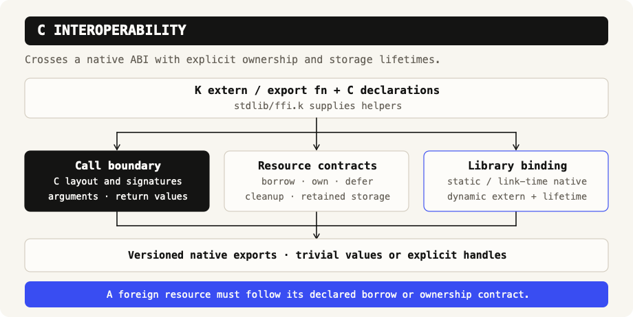](docs/diagrams/svg/c-interop.svg)

`extern` and `export fn` connect K to the native C ABI. Borrowed and owned handles
make resource transfer explicit. Native libraries can take part in the link or be
loaded through a dynamic `extern` declaration.
[Owning C handles](docs/reference.md#owning-c-handles) ·
[Dynamic externs](docs/design/dynamic_externs.md)

### CLI, builds, and packages

[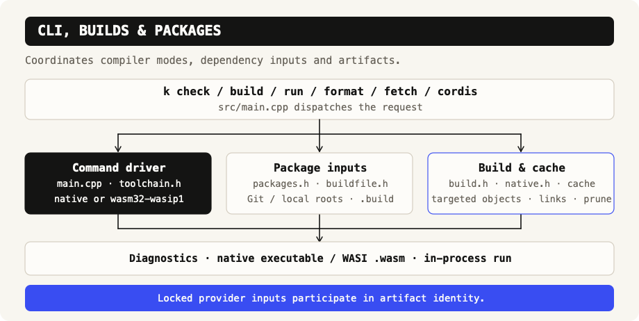](docs/diagrams/svg/toolchain.svg)

`k` checks, runs, builds, and formats programs, resolves packages, and inspects
Cordis graphs. Package resolution supplies local or cached Git roots and native
build metadata. `--target` selects native or WASI builds. Managed artifacts
are keyed by build inputs, target and toolchain, and can be pruned.
[Command line](docs/command_line.md) · [Packages](docs/packages.md)

### Language server

[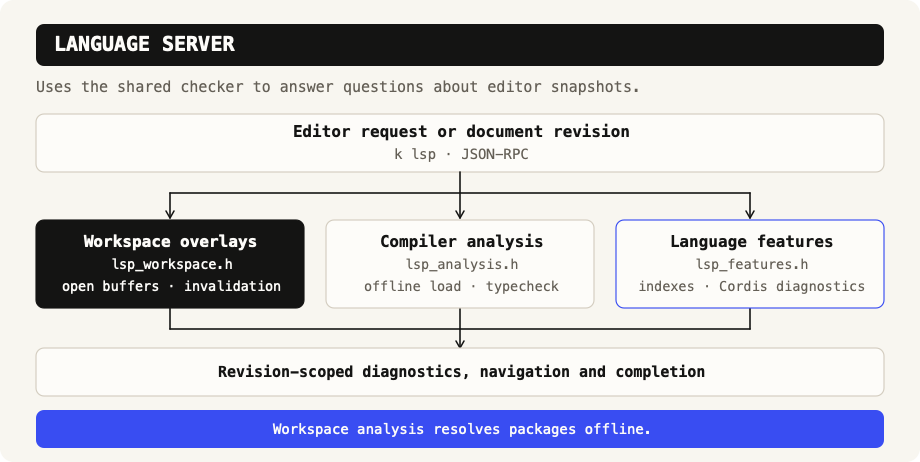](docs/diagrams/svg/language-server.svg)

`k lsp` serves JSON-RPC over stdio. Its workspace overlays open buffers on disk,
reuses the compiler's analysis, and publishes diagnostics for the relevant revision.
An explicitly selected Cordis provider can supplement diagnostics.
[Editor integration](docs/editors.md) · [Language server design](docs/design/language_server.md)

### Cordis microkernel

[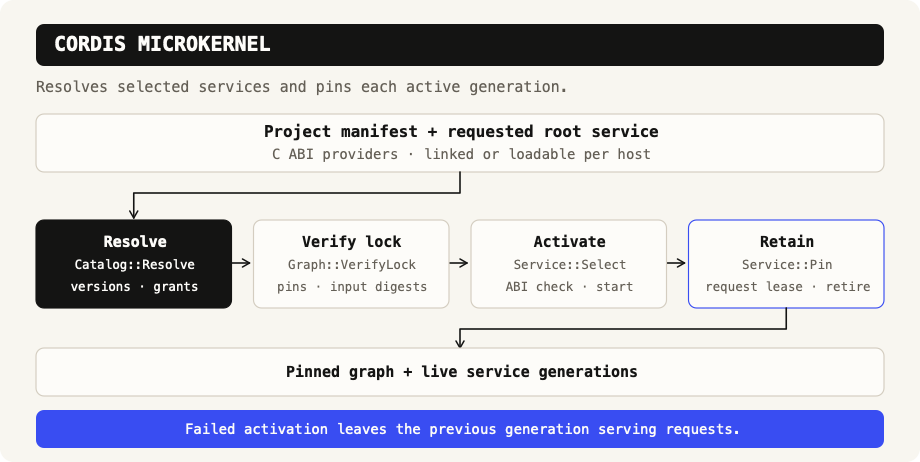](docs/diagrams/svg/cordis.svg)

The catalog resolves one selected provider per service and checks dependency
versions and capabilities. Hosts verify digests, check the service ABI, and start
a candidate before activation. A request pins its generation through completion.
A failed replacement preserves the active generation.
[Graph resolution](docs/design/cordis_microkernel.md#resolving-a-provider-graph) ·
[Service lifecycle](docs/design/cordis_microkernel.md#shared-native-service-lifecycle)

### Guest languages

[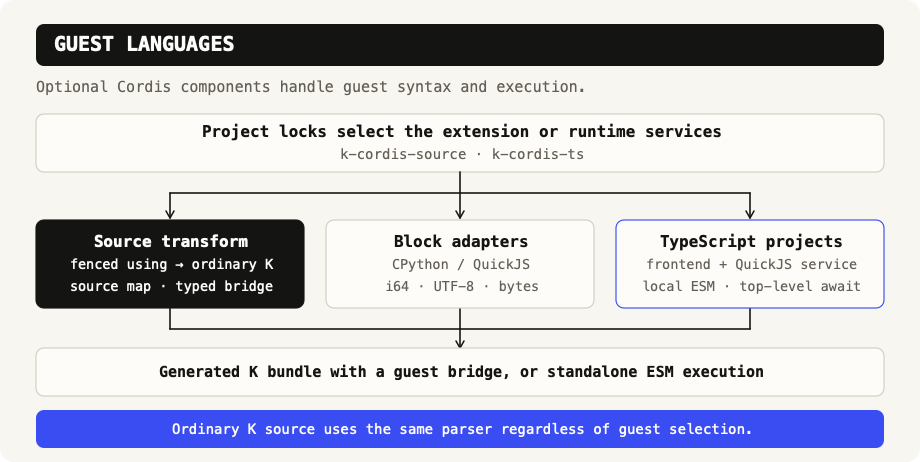](docs/diagrams/svg/guest-languages.svg)

The optional `k-cordis-source` driver transforms fenced `using` blocks into ordinary
K and typed calls to CPython or QuickJS. The separate `k-cordis-ts` runner selects
the TypeScript frontend and QuickJS through Cordis and executes local ESM with
top-level `await`. These adapters and runners are separate build options, not core
compiler dependencies. Node.js API and npm project compatibility remain roadmap
work for an optional Cordis profile.
[Embedded languages](docs/design/embedded_languages.md) ·
[TypeScript project runner](docs/design/functions_and_typescript_runtime.md#optional-project-runner)

### Hosted providers

[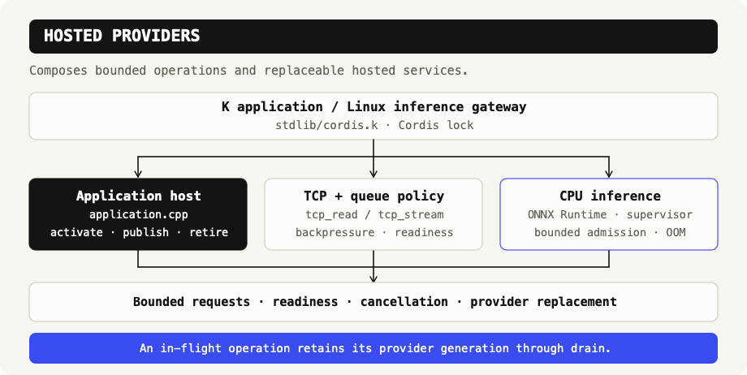](docs/diagrams/svg/hosted-providers.svg)

The optional host activates TCP and queue-policy providers from a verified graph.
The optional Linux cloud profile adds an inference gateway with a replaceable
ONNX Runtime CPU provider, bounded admission, and supervised memory-limit recovery.
The gateway, provider and ONNX Runtime are Cordis deployment components, not K
core dependencies.
[Bounded TCP streams](docs/design/cordis_microkernel.md#bounded-tcp-streams) ·
[Inference gateway](docs/design/cordis_microkernel.md#loopback-inference-gateway)

### Libraries and native packages

[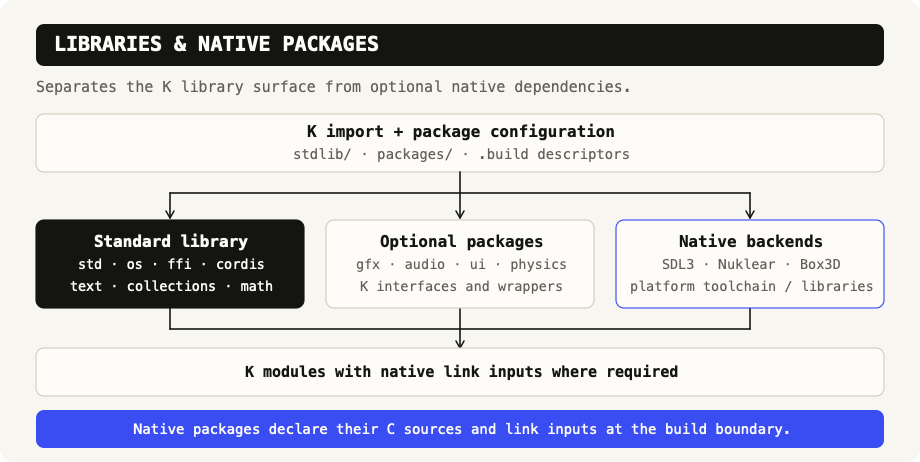](docs/diagrams/svg/libraries.svg)

`stdlib/` contains core utilities, collections, I/O and native interface helpers.
`packages/` supplies optional graphics, audio, UI, and physics APIs with native
build inputs described by `.build` files.
[Standard library](docs/stdlib.md) · [Native package dependencies](docs/packages.md)

## Project status

K supports generics, tagged enums and pattern matching, concrete closures and
specialized higher-order functions, checked dynamic callables, typed decorators,
`async fn`, and structured task scopes. Hosted TCP and CPU inference workloads
are reference deployments. WASI command programs run in Wasmtime. The roadmap
tracks freestanding boot, wider Node.js compatibility, and production operating
system, cloud, and AI targets.
[Development roadmap](docs/roadmap.md#milestones)

## Build from source

Use CMake 3.27 or newer, a C++20 compiler, Git, and Python 3 for the tests.
Run the build from the repository root.

```sh
cmake -S . -B build -DCMAKE_BUILD_TYPE=Release
cmake --build build --config Release --parallel
```

Add `-DK_BUILTIN_LIBS=all` at configure time to include the graphics,
audio, UI, and physics packages. On macOS, install Xcode or the Xcode Command
Line Tools. With the Visual Studio generator, the compiler is
`build/Release/k.exe`. [Toolchain configuration](docs/command_line.md) ·
[Native package dependencies](docs/packages.md)

## Install a release

### Quick install (one-liner)

The installers verify `SHA256SUMS`, preserve the compiler's runtime layout under
`~/.klang/current` (`$HOME\.klang\current` on Windows), and add `k` to `PATH`.

**macOS / Linux:**

```sh
curl -fsSL https://raw.githubusercontent.com/kense-labs/klang/main/scripts/install.sh | sh
```

**Windows (PowerShell):**

```powershell
irm https://raw.githubusercontent.com/kense-labs/klang/main/scripts/install.ps1 | iex
```

Pass `--version <tag>`, `--profile <default|core|cloud>`, `--dir <path>`, or
`--no-modify-path` (`-Version`, `-InstallDir`, `-NoModifyPath` on PowerShell) to
customize the install:

```sh
# Install a specific preview with the reproducible macOS arm64 core or Linux cloud profile
curl -fsSL https://raw.githubusercontent.com/kense-labs/klang/main/scripts/install.sh | \
  sh -s -- --version v0.1.0-preview.1 --profile core
```

### Manual archive install

When a prebuilt archive is available for your platform, check its SHA-256
checksum against the release's `SHA256SUMS`, extract it, and put the directory
containing `k` on `PATH`. Keep the runtime files beside the executable. On
Linux, in-process execution needs the development headers for the system C
library. On macOS it needs the SDK from Xcode or the Command Line Tools.
[GitHub releases](https://github.com/kense-labs/klang/releases)

Choose the Linux `cloud` archive for the prebuilt Cordis inference gateway
and ONNX Runtime CPU provider. Supply a model and resolve the provider
lock with the `k` from the archive.
[Gateway setup](docs/design/cordis_microkernel.md#loopback-inference-gateway)

## Run a program

Save this program as `hello.k`.

```klang
import std;

fn main() {
    let numbers: i64[4] = [1, 2, 3, 4];
    print(numbers.map() { it * it });
}
```

```sh
build/k check hello.k
build/k run hello.k
build/k build -o build/hello hello.k
./build/hello
```

Both runs print `[1, 4, 9, 16]`. `k run` executes generated C in-process
through TinyCC. `k build` uses a C toolchain to produce a native executable
and supports programs with worker threads. Use `k` in place of `build/k`
after adding it to `PATH`. [More programs](samples/README.md)

### Build a WebAssembly executable

With WASI SDK and Wasmtime installed, set `WASI_SDK_PATH` to the SDK directory
and build the same `hello.k` as a WASI Preview 1 command.

```sh
export WASI_SDK_PATH=/path/to/wasi-sdk
build/k build --target wasm32-wasip1 hello.k -o build/hello.wasm
wasmtime run build/hello.wasm  # [1, 4, 9, 16]
```

[WASM build options](docs/command_line.md#webassembly-executables)

## Develop K

- Learn the language with the [tutorial](docs/tutorial.md), [language reference](docs/reference.md), and [standard library](docs/stdlib.md).
- Work on the compiler with the [specification](docs/k_spec.md), [implementation notes](docs/implementation.md), and [testing guide](docs/testing.md).
- Connect an editor with the [VS Code extension](vscode/README.md) or the [language server guide](docs/editors.md).
- Follow the [architecture](docs/architecture.md), [roadmap](docs/roadmap.md), and [design notes](docs/index.md#design-notes).

Run the baseline compiler regression suite with Clang available.

```sh
python3 test/run_tests.py --profile baseline --cc native --require-clang
```

## License

K's original contributions are available under the [MIT License](LICENSE).
Inherited code is subject to the Apache License 2.0. Components with their
own license notices are distributed under those notices.
[Apache License 2.0](LICENSE-APACHE) · [Source and attribution notices](NOTICE)
