<picture>
  <source media="(prefers-color-scheme: dark)" srcset="docs/logo/kense-mark-dark.png">
  
</picture>

# K 编程语言

[English](README.md) · 简体中文

[架构](#核心架构) · [模块](#模块架构) · [构建](#从源码构建) · [运行程序](#运行程序) ·
[WebAssembly](#构建-webassembly-可执行程序) ·
[路线图](docs/roadmap.md)

K 是一门内存安全的系统编程语言。编译器检查引用的生命周期，程序可以显式控制存储。
可增长的值放在地址稳定的数据栈上，作用域退出时回收对应存储。K 使用 C 后端构建
本机和 WASI WebAssembly 可执行程序。命令行工具为 `k`，源文件扩展名为 `.k`。

K 的长期目标是服务于操作系统组件、云服务和 AI 基础设施。首个生产目标是云端推理网关。
裸机启动和通过 Cordis 兼容 Node.js 项目都在路线图上。

## 核心架构

[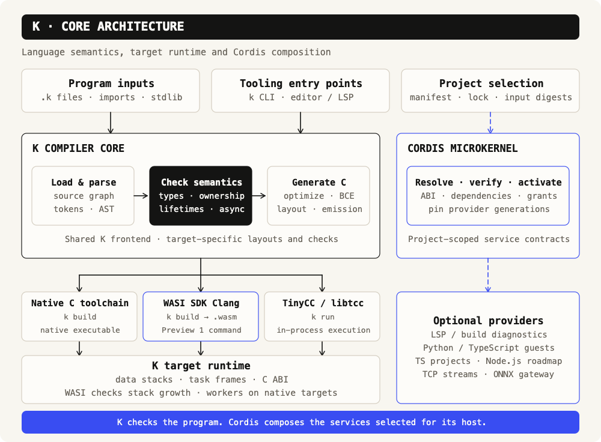](docs/diagrams/svg/core-architecture.svg)

编译器定义语法、类型、生命周期和检查后的程序表示。本机、WASI 与 TinyCC 共用检查器，
再使用针对各目标生成的 C。K 运行时提供数据栈、任务帧和 C ABI。本机构建还支持工作线程
与类型化消息队列。

Cordis 微内核是 K 的首要设计原则。各宿主通过版本化接口选择服务。经验证的锁文件将
依赖图绑定到提供者版本和受跟踪输入。宿主根据支持的契约静态链接或动态加载提供者。
CPython 与 QuickJS/TypeScript 适配器、TypeScript 及未来的 Node.js 兼容配置、ONNX 推理网关
都是可选 Cordis 组件，拥有独立构建目标和经验证的依赖图，不是 K 编译器或目标运行时的依赖。
[架构说明](docs/architecture.md) · [Cordis 设计](docs/design/cordis_microkernel.md)

## 依赖关系与上下文映射

[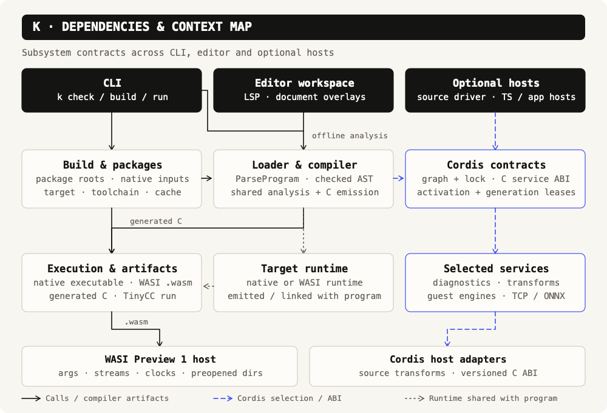](docs/diagrams/svg/context-map.svg)

黑色实线表示调用或编译产物，靛蓝虚线表示 Cordis 选择与服务接口，灰色点线表示
生成程序共用的运行时支持。编辑器将未保存的文档覆盖到分析快照中并离线解析包。
可选的源码驱动将生成的 K 交给常规编译入口。独立的 TypeScript 运行器使用自己的 Cordis 图。
WASI 宿主运行 WebAssembly 命令模块，并通过预开放目录等方式授予资源访问权限。
[子系统边界](docs/architecture.md#domain-boundaries-in-the-code)

## 模块架构

点击任意架构图可打开可编辑的 SVG 源文件。

### 编译器前端

[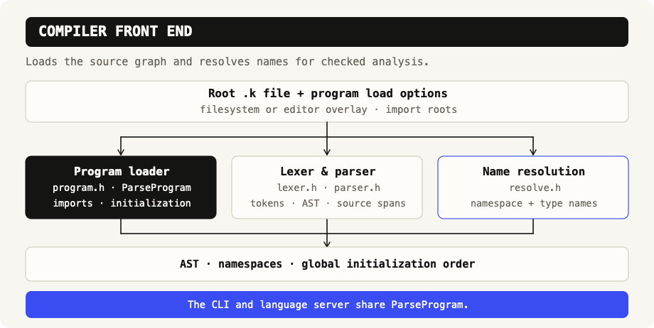](docs/diagrams/svg/compiler-front-end.svg)

`program.h` 加载导入并确定全局变量的初始化顺序。词法分析器和解析器保留源码位置。
`resolve.h` 在程序命名空间中解析类型名称。CLI 和语言服务器共用 `ParseProgram`。
[前端实现](docs/implementation.md#2-front-end)

### 语义分析

[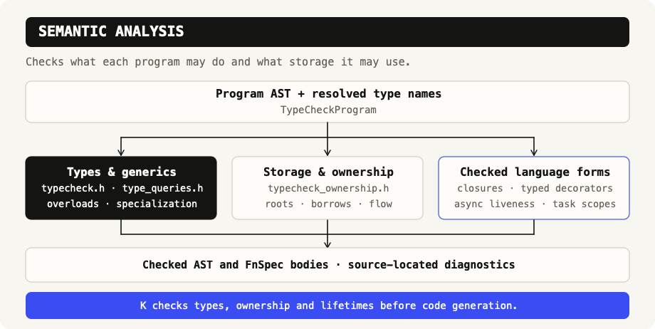](docs/diagrams/svg/semantic-analysis.svg)

检查器为泛型函数生成特化，验证引用根和所有权转移，并检查闭包捕获、类型化装饰器
以及跨挂起点存活的值。后续阶段使用检查后的函数体及其类型和生命周期信息。
[类型检查器](docs/implementation.md#3-the-typechecker) ·
[异步与装饰器](docs/design/async_and_decorators.md)

### 优化与 C 后端

[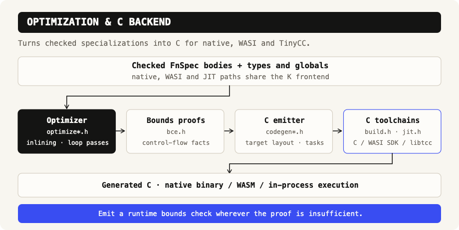](docs/diagrams/svg/c-backend.svg)

优化器处理已检查的特化代码。边界检查消除依赖控制流和别名信息。
C 生成器负责值布局、调用与任务状态机，并在无法证明安全的位置生成运行时检查。
[编译流水线](docs/implementation.md#1-pipeline) ·
[边界检查消除](docs/implementation.md#5-bounds-check-elimination)

### WebAssembly 目标

[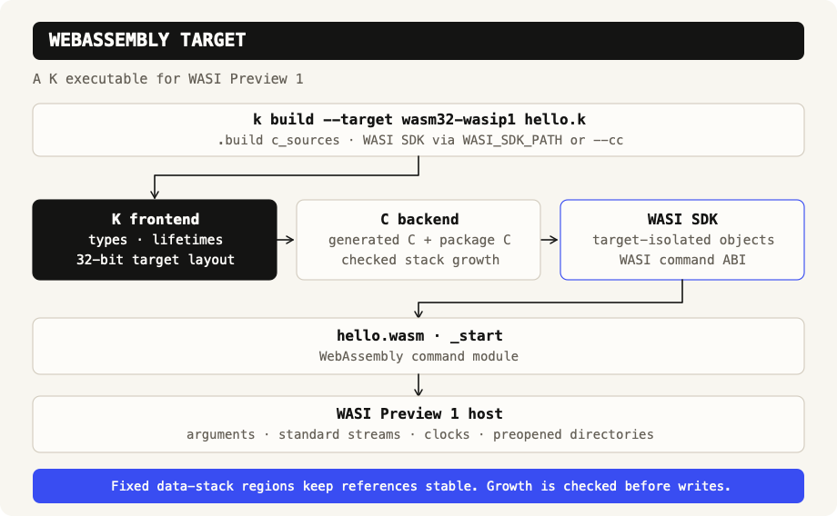](docs/diagrams/svg/webassembly-target.svg)

`k build --target wasm32-wasip1` 生成内含 K 运行时的 `.wasm` 命令模块。
数据栈在线性内存中使用地址稳定的固定区域，编译器和运行时在写入前检查剩余容量。
当前支持协作式异步任务、标准输入输出、命令行参数、时钟和预开放目录内的文件访问。
包的 `.build` 文件声明的普通 C 源码使用同一 WASI 工具链编译并链接进模块；包缓存按目标
和工具链隔离。工作线程、动态 `extern` 库、CMake 与内建本机包、浏览器和组件模型宿主仍在路线图上。
[WebAssembly 设计](docs/design/wasm.md#wasi-command-target) ·
[WASI 集成测试](docs/testing.md#wasi-command-target)

### 目标运行时

[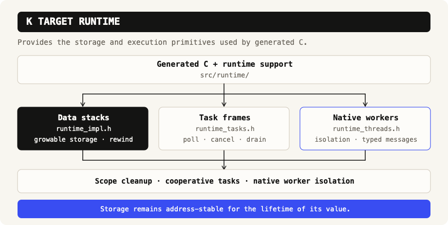](docs/diagrams/svg/target-runtime.svg)

可增长的局部值使用地址稳定的数据栈，存储可在作用域退出时回退。
任务帧保存 `await` 所需的状态，并在取消时执行清理。
本机构建支持隔离的工作线程以及线程间的类型化消息队列。
[运行时实现](docs/implementation.md#7-the-runtime) ·
[词法任务作用域](docs/design/async_and_decorators.md#lexical-task-scopes)

### C 互操作

[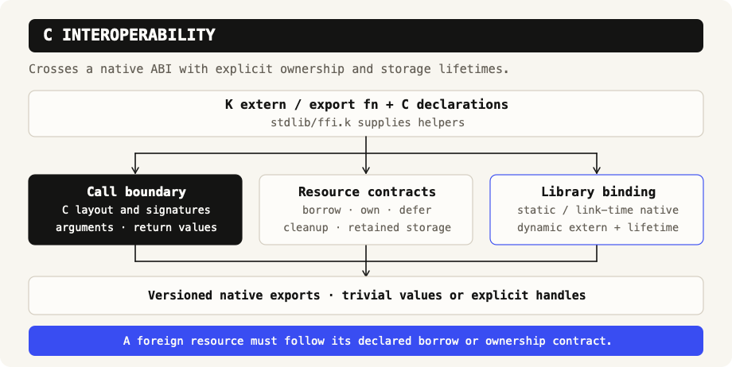](docs/diagrams/svg/c-interop.svg)

`extern` 和 `export fn` 连接 K 与本机 C ABI。借用和拥有句柄明确表达资源转移。
C 库可以在构建时链接，也可以通过动态 `extern` 声明加载。
[拥有 C 句柄](docs/reference.md#owning-c-handles) · [动态 extern](docs/design/dynamic_externs.md)

### CLI、构建与包管理

[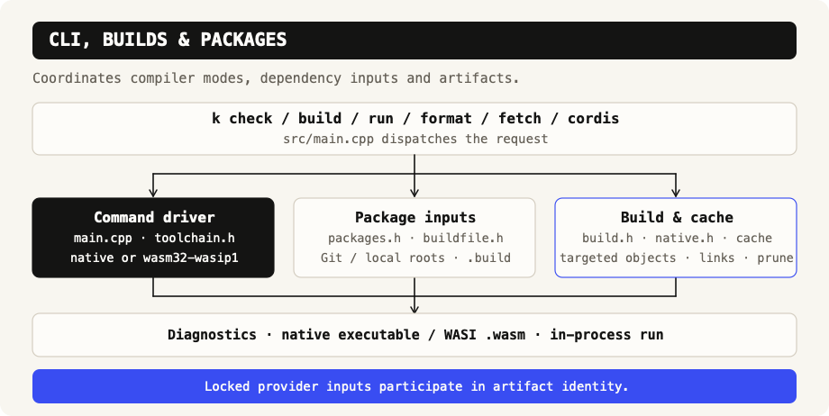](docs/diagrams/svg/toolchain.svg)

`k` 检查、运行、构建和格式化程序，也支持解析包和检查 Cordis 图。
包解析提供本地目录或缓存的 Git 源码及本机构建信息。`--target` 用于选择本机或 WASI 构建。
构建输入、目标和工具链共同决定受管产物的缓存标识，
闲置产物可以清理。[命令行](docs/command_line.md) · [包管理](docs/packages.md)

### 语言服务器

[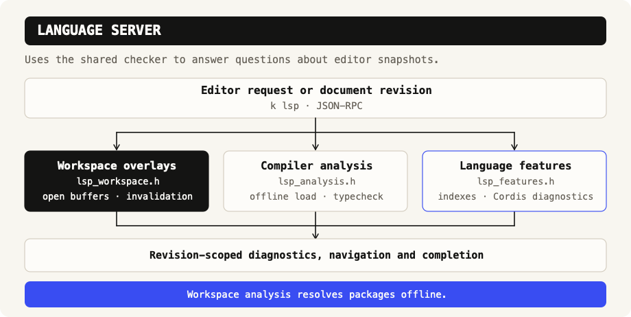](docs/diagrams/svg/language-server.svg)

`k lsp` 通过标准输入输出提供 JSON-RPC。工作区用打开的缓冲区覆盖磁盘文本，
复用编译器分析，并按文档修订发布诊断。项目可通过显式选择的 Cordis 提供者补充诊断。
[编辑器接入](docs/editors.md) · [语言服务器设计](docs/design/language_server.md)

### Cordis 微内核

[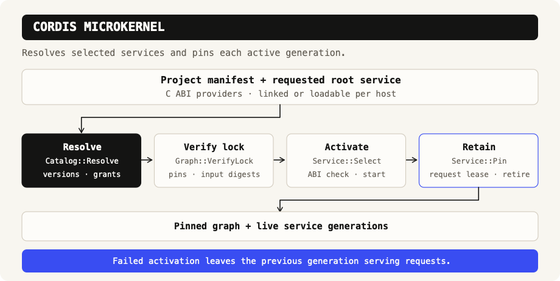](docs/diagrams/svg/cordis.svg)

目录为每项服务解析已选提供者，并检查依赖版本和能力。宿主验证摘要、检查服务 ABI，
在发布前启动候选提供者。请求保留启动时使用的服务代际直至完成。
替换失败时，原代际继续服务。
[依赖图解析](docs/design/cordis_microkernel.md#resolving-a-provider-graph) ·
[服务生命周期](docs/design/cordis_microkernel.md#shared-native-service-lifecycle)

### 客体语言

[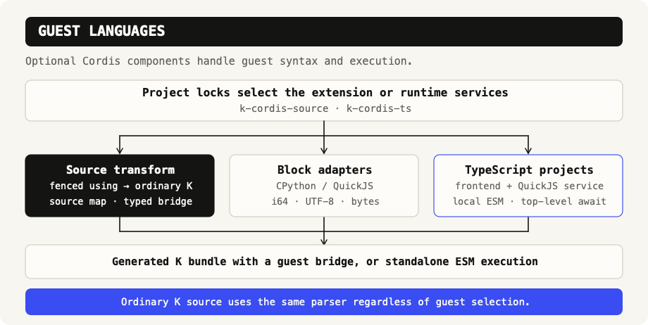](docs/diagrams/svg/guest-languages.svg)

可选的 `k-cordis-source` 驱动将围栏 `using` 块转换为普通 K 和对 CPython 或 QuickJS
的类型化调用。独立的 `k-cordis-ts` 通过 Cordis 选择 TypeScript 前端和 QuickJS，
执行带顶层 `await` 的本地 ESM。这些适配器和运行器均为独立构建选项，不是核心编译器依赖。
Node.js API 和 npm 项目兼容性仍是可选 Cordis 配置的路线图工作。
[嵌入式语言](docs/design/embedded_languages.md) ·
[TypeScript 项目运行器](docs/design/functions_and_typescript_runtime.md#optional-project-runner)

### 宿主服务

[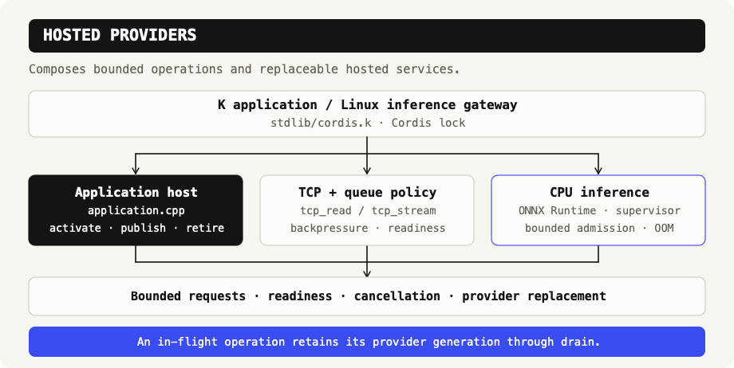](docs/diagrams/svg/hosted-providers.svg)

可选的应用宿主从已验证的图激活 TCP 和队列策略提供者。可选 Linux 云配置增加一个推理网关，
可替换 ONNX Runtime CPU 提供者，限制并发请求，并由监督进程处理内存超限后的恢复。
网关、提供者和 ONNX Runtime 都是 Cordis 部署组件，不是 K 核心依赖。
[有界 TCP 流](docs/design/cordis_microkernel.md#bounded-tcp-streams) ·
[推理网关](docs/design/cordis_microkernel.md#loopback-inference-gateway)

### 标准库与本机包

[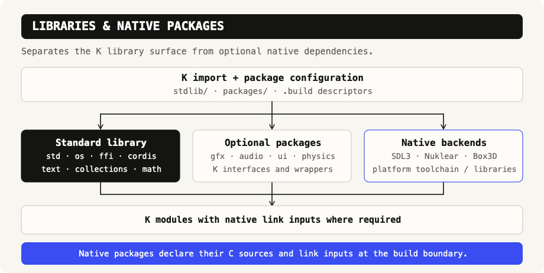](docs/diagrams/svg/libraries.svg)

`stdlib/` 提供基础工具、集合、I/O 和本机接口辅助函数。`packages/` 提供可选的图形、
音频、UI 和物理 API，使用 `.build` 文件描述本机构建输入。
[标准库](docs/stdlib.md) · [本机包依赖](docs/packages.md)

## 项目状态

K 支持泛型、带标签的枚举与模式匹配、具体闭包、特化高阶函数、受检查的动态可调用值、
类型化装饰器、`async fn` 和结构化任务作用域。TCP 与 CPU 推理是当前的宿主参考工作负载。
WASI 命令模块已在 Wasmtime 上验证。
后续里程碑包括裸机启动、更广泛的 Node.js 兼容，以及操作系统、云和 AI 生产目标。
[开发路线图](docs/roadmap.md#milestones)

## 从源码构建

使用 CMake 3.27 或更新版本、支持 C++20 的编译器和 Git。运行测试还需要 Python 3。
在仓库根目录执行以下命令。

```sh
cmake -S . -B build -DCMAKE_BUILD_TYPE=Release
cmake --build build --config Release --parallel
```

配置时加入 `-DK_BUILTIN_LIBS=all` 可包含图形、音频、UI 和物理包。
macOS 需要 Xcode 或 Xcode Command Line Tools。使用 Visual Studio 生成器时，
编译器路径为 `build/Release/k.exe`。
[工具链配置](docs/command_line.md) · [本机包依赖](docs/packages.md)

## 安装发行版

如果平台有预构建包，先对照发布中的 `SHA256SUMS` 校验，再将解压后包含 `k` 的目录
加入 `PATH`。运行时文件需与可执行文件保持在同一安装布局中。
在 Linux 上使用进程内执行需要系统 C 库开发头文件。macOS 需要 Xcode 或
Command Line Tools 提供的 SDK。[GitHub Releases](https://github.com/kense-labs/klang/releases)

Linux 的 `cloud` 压缩包包含预构建的 Cordis 推理网关和 ONNX Runtime CPU 提供者。
准备模型后，用包内的 `k` 解析提供者锁。
[网关配置](docs/design/cordis_microkernel.md#loopback-inference-gateway)

## 运行程序

将以下程序保存为 `hello.k`。

```klang
import std;

fn main() {
    let numbers: i64[4] = [1, 2, 3, 4];
    print(numbers.map() { it * it });
}
```

```sh
build/k check hello.k
build/k run hello.k
build/k build -o build/hello hello.k
./build/hello
```

两次运行都输出 `[1, 4, 9, 16]`。`k run` 通过 TinyCC 在当前进程执行生成的 C。
`k build` 调用 C 工具链生成本机可执行文件，支持包含工作线程的程序。
将编译器加入 `PATH` 后即可使用 `k`。[更多示例](samples/README.md)

### 构建 WebAssembly 可执行程序

安装 WASI SDK 和 Wasmtime，将 `WASI_SDK_PATH` 指向 SDK 目录。用同一份 `hello.k`
构建 WASI Preview 1 命令模块。

```sh
export WASI_SDK_PATH=/path/to/wasi-sdk
build/k build --target wasm32-wasip1 hello.k -o build/hello.wasm
wasmtime run build/hello.wasm  # [1, 4, 9, 16]
```

[WASM 构建选项](docs/command_line.md#webassembly-executables)

## 参与开发

- 学习语言可查阅[教程](docs/tutorial.md)、[语言参考](docs/reference.md)和[标准库](docs/stdlib.md)。
- 开发编译器可查阅[语言规范](docs/k_spec.md)、[实现笔记](docs/implementation.md)和[测试指南](docs/testing.md)。
- 接入编辑器可使用 [VS Code 扩展](vscode/README.md)或参考[语言服务器指南](docs/editors.md)。
- 技术方向见[架构说明](docs/architecture.md)、[路线图](docs/roadmap.md)和[设计笔记](docs/index.md#design-notes)。

安装 Clang 后执行编译器基线回归测试。

```sh
python3 test/run_tests.py --profile baseline --cc native --require-clang
```

## 许可证

K 的原创贡献采用 [MIT 许可证](LICENSE)。继承代码适用 Apache License 2.0。
带有独立许可证声明的组件按各自的声明分发。
[Apache License 2.0](LICENSE-APACHE) · [来源与署名说明](NOTICE)
