# Architecture & Kense OS Diagrams

This visual guide brings together K's **Kense OS architecture diagrams** — covering memory storage on data stacks, compile-time bounds-check elimination, structured concurrency, the compiler pipeline, native and WebAssembly targets, benchmarks, and the Cordis component microkernel.

Select any diagram to inspect it fullscreen or open its editable vector SVG source.

## Core language & runtime mechanics

### Data stacks & value lifetimes

[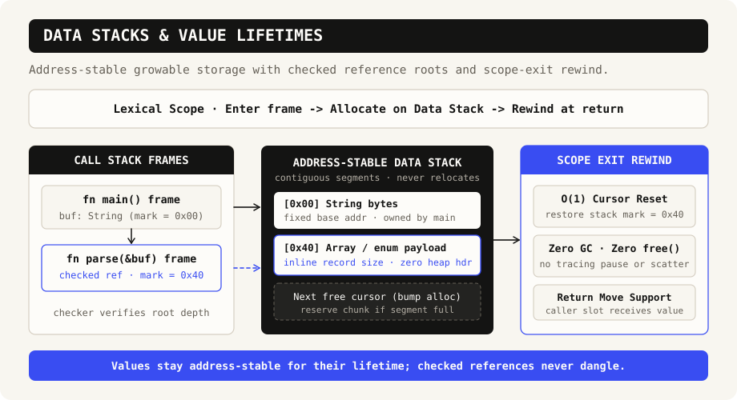](diagrams/svg/data-stacks-memory.svg)

K avoids tracing garbage collection and per-object heap fragmentation by storing growable values (`String`, `Array`, variable-mode `enum` records) on address-stable data stacks. References inside nested frames remain valid while borrowed, and leaving a scope rewinds the stack mark in constant time. See [K architecture](architecture.md#start-with-the-resource) and [Runtime implementation](implementation.md#7-the-runtime).

### Optimization & bounds-check elimination

[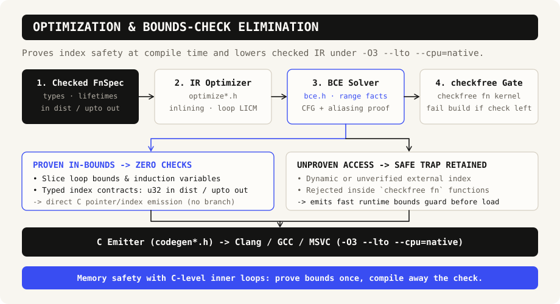](diagrams/svg/optimization-bce-pipeline.svg)

Bounds checks proven safe from control flow, slice ranges, or typed index contracts (`u32 in dist`, `u32 upto out`) are eliminated before C generation. Kernels annotated with `checkfree fn` turn any remaining unverified bounds check into a compile error. See [Bounds-check elimination](implementation.md#5-bounds-check-elimination) and [The optimizer](implementation.md#4-the-optimizer).

### Structured async & isolated workers

[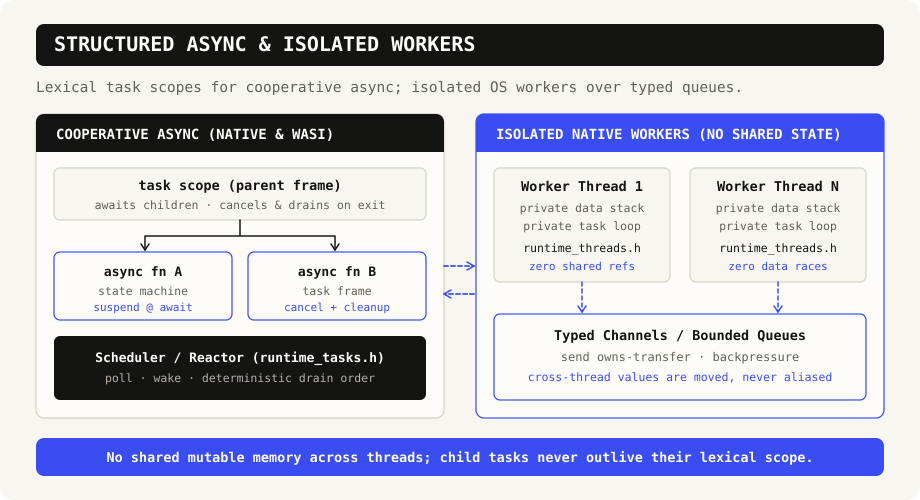](diagrams/svg/async-tasks-workers.svg)

Single-threaded `async fn` tasks compile to explicit state-machine task frames (`runtime_tasks.h`) governed by lexical task scopes with deterministic cancellation and cleanup. Multi-core parallelism uses isolated native worker threads (`runtime_threads.h`), each owning its own data stack and exchanging moved values through typed queues. See [Async functions and decorators](design/async_and_decorators.md) and [Reference § Workers](reference.md).

### Performance & memory profile

[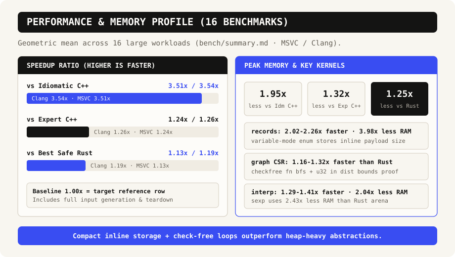](diagrams/svg/benchmark-architecture.svg)

Across the 16 large benchmark workloads, compact inline representation and `checkfree` loops give K geometric-mean speedups of **3.51x / 3.54x** over idiomatic C++, **1.24x / 1.26x** over expert C++, and **1.13x / 1.19x** over safe Rust while lowering peak memory by **1.25x–1.95x**. See [Benchmark summary](../bench/summary.md) and [October 2026 report](../bench/summary.md).

---

## System & compiler pipeline

### Core architecture

[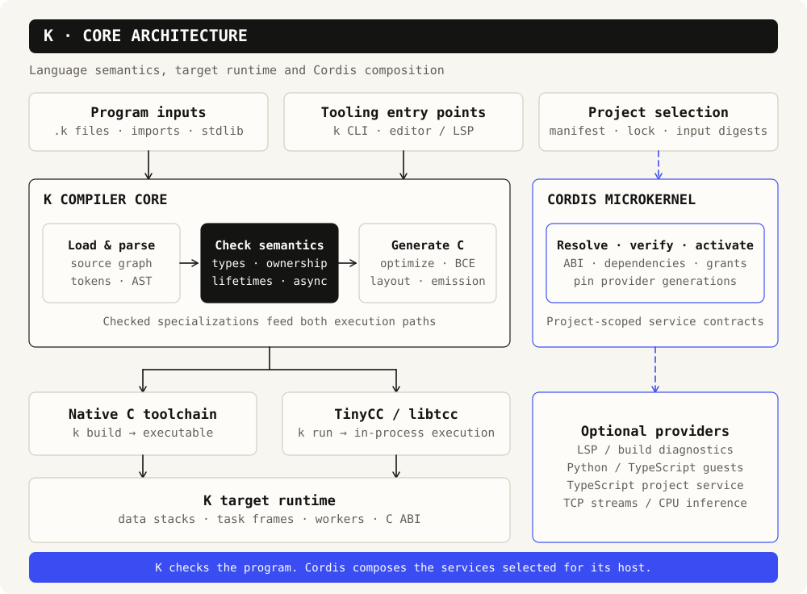](diagrams/svg/core-architecture.svg)

One checked compiler frontend feeds native C builds, WASI WebAssembly command modules, and in-process TinyCC JIT execution. See [K architecture](architecture.md).

### Dependencies & context map

[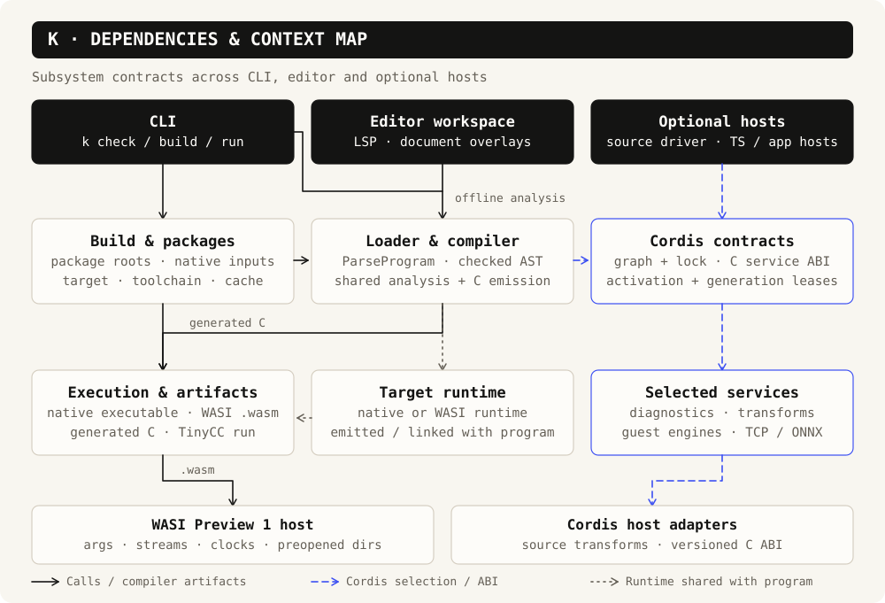](diagrams/svg/context-map.svg)

Explicit bounded contexts separate program loading, package resolution, language semantics, build drivers, and editor workspace overlays. See [Domain boundaries in the code](architecture.md#domain-boundaries-in-the-code).

### Compiler front end

Both `k` CLI builds and `k lsp` share `ParseProgram` and preserve full source spans for accurate diagnostics. See [Front-end implementation](implementation.md#2-front-end).

### Semantic analysis

[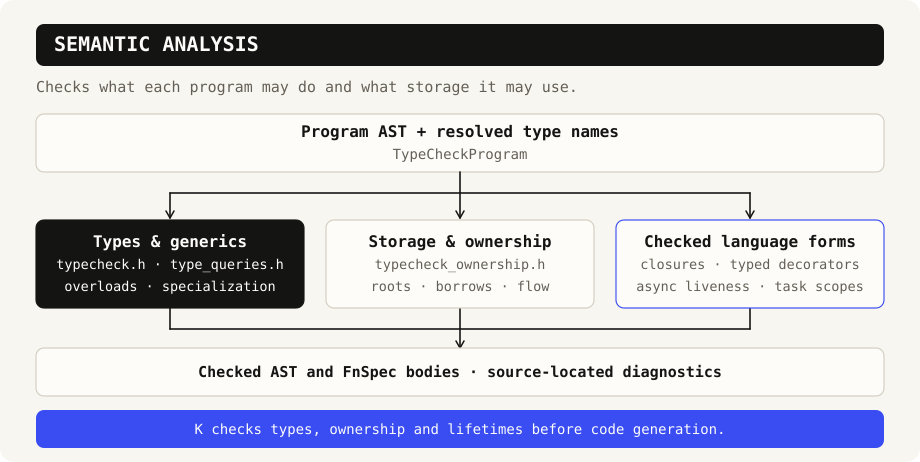](diagrams/svg/semantic-analysis.svg)

Validates reference roots, ownership moves, closure captures, typed decorators, and suspension-safe async values. See [The typechecker](implementation.md#3-the-typechecker).

### Optimization & C backend

[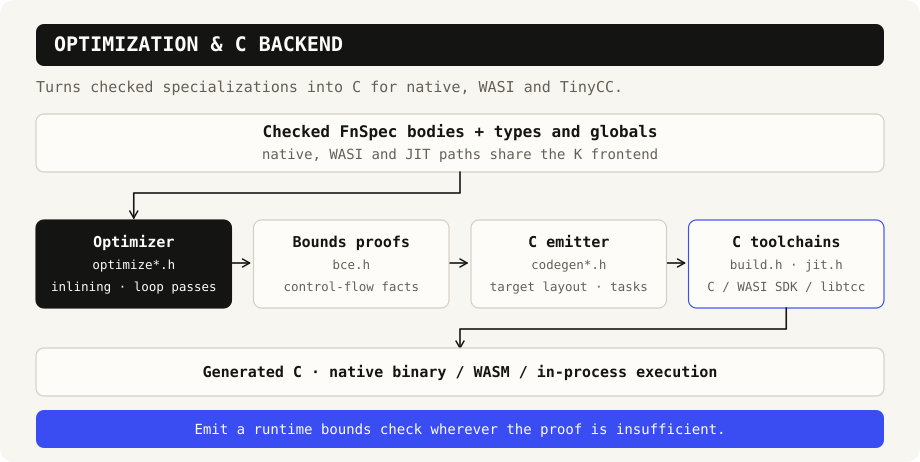](diagrams/svg/c-backend.svg)

Lowers specialized `FnSpec` bodies into portable C layouts and state machines across every backend target. See [Compiler pipeline](implementation.md#1-pipeline).

---

## Runtime, targets & tooling

### Target runtime

[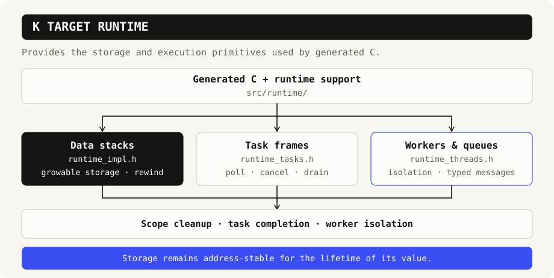](diagrams/svg/target-runtime.svg)

The minimal C runtime provides data-stack storage (`runtime_impl.h`), task frames (`runtime_tasks.h`), and worker queues (`runtime_threads.h`). See [Runtime implementation](implementation.md#7-the-runtime).

### WebAssembly target

[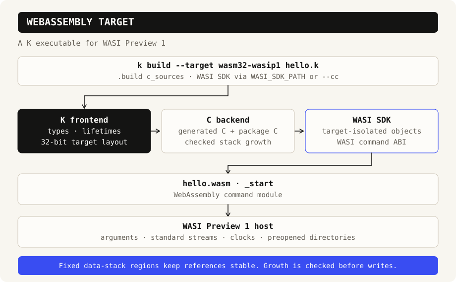](diagrams/svg/webassembly-target.svg)

`k build --target wasm32-wasip1` targets WASI Preview 1 with address-stable data stacks inside 32-bit linear memory. See [WebAssembly design](design/wasm.md#wasi-command-target).

### C interoperability

[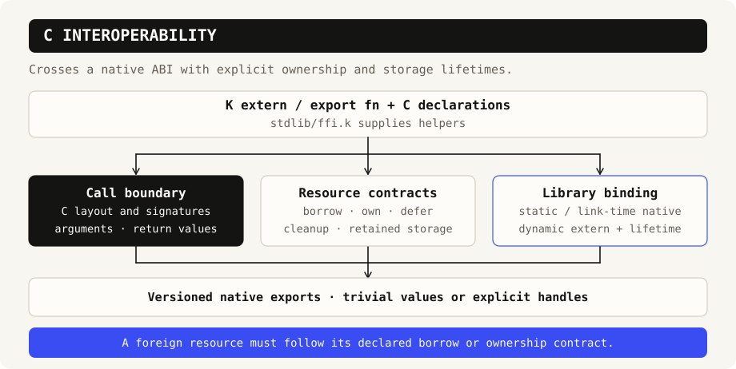](diagrams/svg/c-interop.svg)

Explicit borrowed and owned handle contracts keep FFI boundaries clear across static links and `dynamic extern` libraries. See [Owning C handles](reference.md#owning-c-handles) and [Dynamic externs](design/dynamic_externs.md).

### Toolchain, packages & language server

[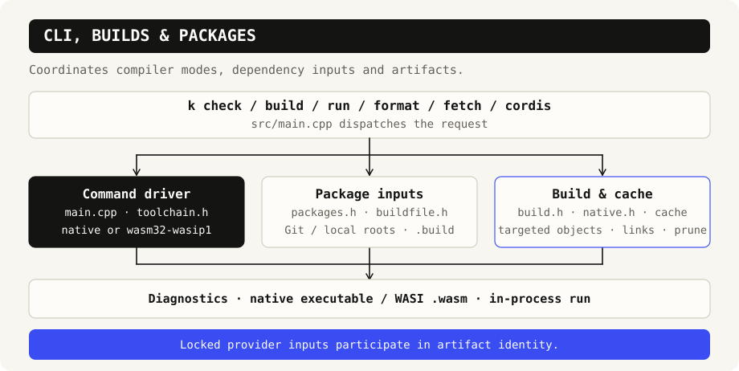](diagrams/svg/toolchain.svg)

[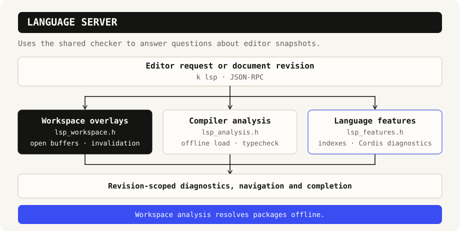](diagrams/svg/language-server.svg)

[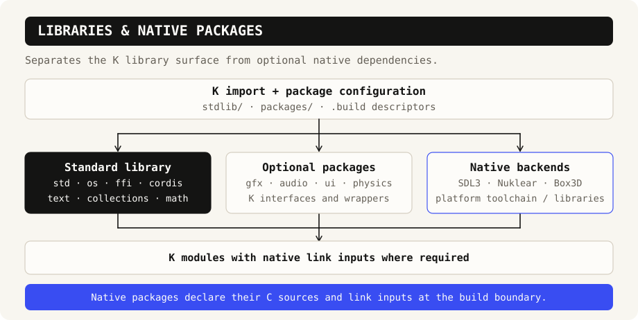](diagrams/svg/libraries.svg)

Unified CLI commands (`k run`, `k build`, `k check`, `k fmt`, `k pkg`, `k lsp`) share the compiler's offline cache and lock resolution. See [Command line](command_line.md), [Packages](packages.md), and [Editor integration](editors.md).

---

## Cordis microkernel & host integration

### Cordis lifecycle

[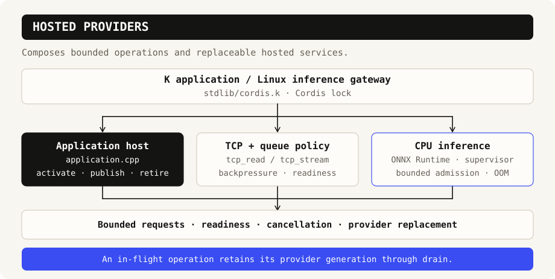](diagrams/svg/hosted-providers.svg)

Hosts resolve service providers from a verified lockfile, check ABI compatibility before activation, and pin in-flight requests to their generation until completion. See [Cordis microkernel design](design/cordis_microkernel.md) and [Embedded languages](design/embedded_languages.md).
