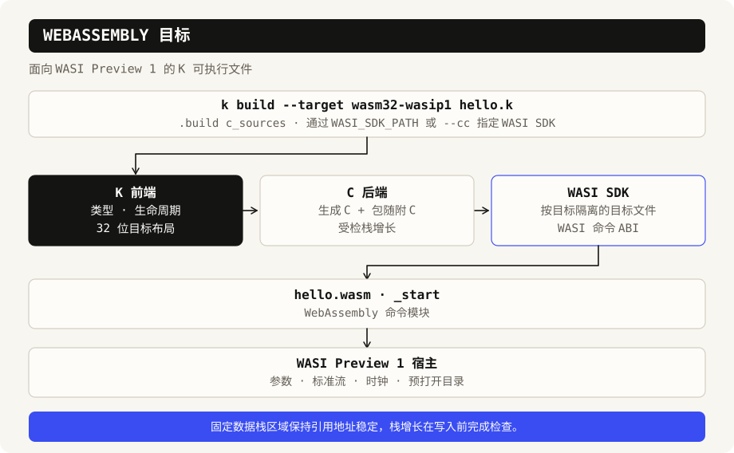

# 在 WebAssembly 上运行 K

目录

- [WASI 命令目标](#wasi-command-target)
- [1. 问题所在](#1-the-problem)
- [2. 每种方案都需要的内容：增长检查](#2-what-every-option-needs-growth-checks)
- [3. 固定分区](#3-fixed-partitions)
- [4. 可重定位栈](#4-relocating-stacks)
- [5. 目前不可行的方案](#5-options-that-do-not-work-today)
- [6. 重定位改造的影响范围](#6-where-relocations-changes-fall)
- [7. 数据栈之外的 Wasm 开销](#7-wasm-costs-outside-the-data-stacks)
- [建议](#recommendation)

## WASI 命令目标

`k build --target wasm32-wasip1` 会生成一个带有 WASI Preview 1 入口点的 WebAssembly 命令模块。编译器按 32 位目标布局检查 K 程序，生成 C 代码作为构建中间产物，并调用 WASI SDK Clang 及其链接器。在 WASI 运行时中运行生成的 `.wasm`。
[构建命令](../command_line.md#webassembly-executables) ·
[WASI SDK](https://github.com/WebAssembly/wasi-sdk) ·
[Wasmtime CLI](https://docs.wasmtime.dev/cli.html)

当前目标采用 §3 中的固定分区。每个栈在线性内存中获得一块地址稳定的分配区域。编译器和 C 运行时会在写入超出其容量之前检查增长，包括循环缓存其栈顶的情况。`--stack-reserve` 可将每个区域的初始预留大小从 8 MiB 修改为其他值。分配失败可能会减小某个区域的容量。当增长达到该容量时，K 会报告数据栈溢出。

纯 K 代码与协作式任务使用相同的源语言和检查器。WASI 提供命令行参数、标准流、时钟以及对运行时预打开（preopened）目录的访问。包附属文件声明的纯 C 源码会使用所选的 WASI Clang 编译并链接进命令模块。现有的原生包响应文件与缓存会被复用，并通过目标平台和工具链标识来区分原生目标文件与 WASI 目标文件。C 声明必须匹配 K 的紧凑聚合体和 32 位指针。该目标仍需要工作线程、动态 extern、CMake 与内置原生包，以及浏览器和组件模型（component-model）配置文件支持。WASI Preview 1 未暴露页面丢弃（page discard）功能，因此会丢弃内存的操作将报告失败。

下文比较了几种用于提升容量并支持更多目标平台的备选方案。其中未实测的开销数据均为估算值。

## 1. 问题所在

每个数据栈都是一块预留的虚拟地址空间区域，并在被触及时提交物理内存（[规范 §1.2](../k_spec.md#12-memory-model)、[§10.4](../k_spec.md#104-runtime-environment)、[实现 §7](../implementation.md#7-the-runtime)）。栈增长只是一次不做容量检查的指针递增，而每个区域末尾之外的保护间隙（guard gap）会将越界转化为进程中止（abort）。指向栈内部的引用就是普通地址，并且在栈增长时依然保持有效，因为栈的基址永不移动——整个语言正是围绕这一特性构建的（[教程](../tutorial.md#nothing-moves-so-references-survive-growth)）。

WebAssembly 不具备以上任何机制。模块的线性内存只能在末尾增长，内部没有未映射的页面，并且在 wasm32 中最多只能容纳 4 GB。只为少数几个栈各自划定很小固定大小的移植方案虽然能跑通，但只容得下玩具程序。

## 2. 每种方案都需要的内容：增长检查

线性内存没有保护页（guard page），因此一个区域一旦越界就会直接写入下一个区域。所以每种方案都要检查增长，即 `if (lim - top < n)`，保留固定区域的移植方案也不例外。各方案的区别在于检查失败时的动作：是直接中止，还是移动该栈。只有移动栈才会迫使指针表示方式发生变化。

检查需要放在栈顶向上移动的每一处位置：

* 压栈（push）、追加（append）与 `resize`（`EmitPush`、`EmitAppend`）；
* 原地构造：`str()`、`to_bytes()`、`print` 的渲染输出、先预留再回填的长度前缀（`OpenRzDest`、`EmitReprefix`、`EmitSlidePrefix`、varint 前缀）、栈帧对象、`_er` 孪生函数、生成的遍历器（walker）；
* 运行时：切片池的空闲链表（freelist），它在自己的独立栈上增长（`k_spans_*`）；`klang.h` 中的 `k_bld_append`；以及无界写入栈顶的辅助函数，例如 `k_fmt_i64(top, v)`（最多 20 字节）。这些函数都需要先预留空间：标量按最坏情况预留，渲染嵌套值时则按块（chunk）检查。

栈顶缓存（[实现 §6.10](../implementation.md#610-loop-invariant-views-and-stack-top-caching)）变为 `(top, limit)` 对，并在相同的同步点进行同步。具有已知迭代次数的循环可以在循环前一次性完成预留。

## 3. 固定分区

每个栈获得线性内存中的一段固定切片，检查失败时以与原生构建相同的越界错误信息中止程序。这主要是对现有运行时进行配置：`K_STACK_RESERVE` 为线性内存除以区域数量，而 `K_STACK_BUDGET` 为线性内存总量，运行时已经用它来限制 `hardware_threads()` 的上限。

* **内存占用（RAM）。** 在 64 位桌面引擎上，已经增长但从未触及的线性内存通常不会由物理 RAM 支撑（Windows 会为此计入提交额度），因此启动时直接增长到最大值消耗的是地址空间，而非物理内存。但在小型设备上，浏览器可能会拒绝分配过大的内存，而且 Wasm 在峰值过后无法将页面归还给系统（没有 `memory.discard`）。
* **容量。** 真正的限制在于每个栈各自的大小。程序通常只需要很少的区域：`--stacks` 报告显示 `samples/14_bst` 需要 5 个，`12_huffman` 需要 6 个，`18_json` 需要 10 个（8 个栈和 2 个全局变量的栈），而 `23_mandelbrot_threads` 需要 6 个外加每个工作线程 2 个。将 4 GB 分给 10 个区域，每个栈只有 400 MB。工作线程还会使区域数量成倍增加。
* **基于性能剖析（profile）确定大小。** 可以利用一次代表性运行中各个栈索引的高水位线，为不同分区分配不同的大小。在 Windows 上，缺页异常处理程序会按需提交内存，因此能报告每个区域的深度（其提交水位线）。macOS 和 Linux 则需要显式插桩，才能在栈回退（rewind）过程中追踪出现过的最高栈顶。`K_STACK_STATS` 目前仅报告数量统计。栈编号特定于单次构建，而且性能剖析只契合生成它的那份输入，但真正会溢出的恰恰是较大的输入。
* **开放末端。** 位于线性内存末尾的那个分区可以继续通过 `memory.grow` 增长。如果把最可能存放程序大型可调整大小数据的栈放在那里，最常见的情况（一个大型持续增长的数组）就只受限于内存自身的最大容量。
* **wasm64** 在原则上消除了 4 GB 的地址上限，但浏览器仍然会限制 memory64（V8 上限为 16 GB），而且每次访问都需要显式的边界检查。wasmtime 则可以预留大得多的地址空间并延迟提交。因此，wasm64 下的固定分区与原生模型非常接近，对于 WASI 和服务端目标是切合实际的选择。

## 4. 可重定位栈

每个栈都是一块堆内存块（heap block），当增长检查失败时，它会搬迁到一块两倍大小的新内存块中。既然栈可能会移动，引用就不能保存地址，而必须保存句柄（handle）。

* **编码。** 句柄是一个 `u64`：高位存放栈的 id，低位存放偏移量。id 为 0 的句柄存放普通地址，用于静态数据、C 内存以及 Clang 的影子栈（取过地址的固定局部变量存放在此）。它的基址表（base table）表项为 0。引用仍然保持 8 字节，因此所有布局都与 C 后端所针对的 64 位宿主完全一致（实现 §6.1）。基址表归线程程序所有，与 `k_stks` 类似，同时也覆盖全局变量的专用栈。
* **算术运算保持不变。** `base + i * size`、字段偏移量、遍历可变长字段的游标（`FieldPtr`）、同一栈内的差值以及池的范围测试，全部可以直接在这个整数上完成。只有加载、存储和 `mem*` 调用需要解码句柄；在 wasm32 下，解码操作就是 `bases[h >> 32] + (uint32_t)h`。
* **相对引用和池无需修改。** 它们本质上是单个栈内的偏移量，而整个栈是作为整体一起移动的。
* **解码可以外提。** 解码后的指针只要所在栈不发生增长就始终有效。只要某段代码区间内该栈不会增长，且其中没有任何能触及该栈增长的调用，解码就可以被外提到这段区间之外；而栈顶缓存已经计算好了这些区间（`SyncReach`、`PlanTopCaches`）。通过已外提视图（`AddView`）遍历数组的循环随后就能像原生代码一样运行。开销落在指针追逐（每次通过 `T&` 跳转都需要一次解码）以及压栈操作（其增长检查在固定分区方案中同样需要）上。预计运行时间是固定分区方案的 1.1 到 1.5 倍，其中树和链表代码受影响最大。按倍增策略扩容可以将搬迁时的复制开销均摊掉。算上新旧内存块以及内存碎片，峰值内存占用最多可达存活数据的两到三倍。
* **线程。** 每个线程程序拥有自己线程局部的基址表。启动新线程（spawn）时复制的是扁平映像，因此没有任何句柄会跨线程传递。

## 5. 目前不可行的方案

* **多内存（Multi-memory）。** 为每个栈分配一块内存可以在 `memory.grow` 时保持偏移量稳定，但加载指令必须将内存索引作为立即数指名。而栈是在运行时选定的（`k_sp + k`、胖引用的 `stk`），且 C 语言无法面向多个内存编译。
* **内存控制提案（memory-control proposal）**（`memory.discard`、保护、映射）能够带回地址预留、按需提交和保护页，从而恢复原生内存模型。但该提案尚未正式发布。
* **GC 数组**无法增长，因此它们会像堆内存块那样搬迁重定位，并且 C 代码无法访问它们。
* **一种禁止引用跨越栈增长存活的 Wasm 方言**会破坏该语言赖以建立的核心性质。

## 6. 重定位改造的影响范围

按风险而非规模排序：

1. **同一栈增长期间的原地构造**（见 §2 所列）。在原生构建中，指向槽位起始位置或待回填前缀的已持有指针在栈增长后依然有效。而在重定位方案下，它必须改用句柄，或者在增长后重新推导计算。
2. **基址永不移动的假设。** 视图外提依赖这一假设（其安全性论证基于“增长只修改长度”），栈顶缓存、引用别名（`refalias`）以及 `let first .= v.push(...)` 也同样依赖它。依赖这一假设的代码很少，但绝大多数潜在 bug 都藏在其中。约束这些问题的规则是：全面使用句柄，仅在同步分析所证明的区间内使用解码后的指针。
3. **C 边界**：运行时、`extern fn`、内置认证包和 `klang.h`。C ABI 可以继续使用普通指针。切片和引用在调用边界处解码，因为 C 被调方只能通过 builder 来使 K 栈增长。builder 参数会获得一个暂存栈（staging stack），并在调用返回后将其内容追加到目标栈中。这样各包无需修改即可重新编译，只需为 `k_bld_append` 加上容量检查。
4. **代码生成编写内存访问的方式**，这属于机械性的改动。粗略统计大约有 35 处 `*(T *)` 解引用、140 处生成的 `->`、26 处 `mem*` 调用以及 21 处 `->top`，主要通过 `LoadLoc`、`IndexLoc`、`DerefLoc`、`PointeeLv` 和 `VarLoc` 完成。
5. **保持不变的部分**：解析器、类型检查器、优化器、除视图外提外的边界检查消除（BCE），以及标准库（它本身就是由同一套代码生成编译的 K 源码）。标准库与 C 交互的唯一入口是它的 extern 函数：标量上的数学函数、切片上的 `find_any` 和 `find_pair`、`os` 的 builder，以及 `json` 中带 `i32&` 的 `frexp`。

## 7. 数据栈之外的 Wasm 开销

* **原生调用栈溢出。** 运行时会将其报告为运行时错误（实现 §7）。Wasm 没有向量化异常处理程序（vectored handler）或 `sigaltstack`，因此引擎会直接触发 trap。Clang 的影子栈（默认 64 KB）如果不开启检查会静默溢出（可通过 `-z stack-size`、Emscripten 的 `STACK_OVERFLOW_CHECK` 处理）。
* **操作系统层**（`runtime_os.h`）映射到 WASI 或 Emscripten。
* **线程**需要共享内存，而浏览器只向跨源隔离（cross-origin-isolated）页面提供共享内存。

## 建议

1. 将 §2 中的增长检查作为独立配置加入。原生构建也可以启用该配置运行，从而让现有测试套件覆盖到这些检查。在此基础上，固定分区就只是配置问题，而且它能为栈需求在容量范围内的程序提供一个可用的移植版本。
2. 如果这还不够，先将重定位作为原生配置实现：将栈放进在增长时移动的堆内存块中。为其加入一个在每次增长时都强制移动栈的压力测试设置，让测试套件暴露出所有过期的已解码指针，并用基准测试套件测量开销。完成这些之后，再引入 Wasm 工具链。
