# Kense OS 架构与原理图解中心

本页汇总了 K 语言全套 **18 张简体中文版 Kense OS 系统架构图解**——涵盖数据栈内存与生命周期、编译期边界检查消除（BCE）、结构化异步与隔离线程、性能内存基准、编译器前后端流水线、原生/WASI 目标，以及 Cordis 组件微内核。

点击任意图解卡片右下角 **放大查看** 即可全屏高清检视，或直接打开原始矢量 SVG。

## 核心语言与运行时机制

### 数据栈与值生命周期

[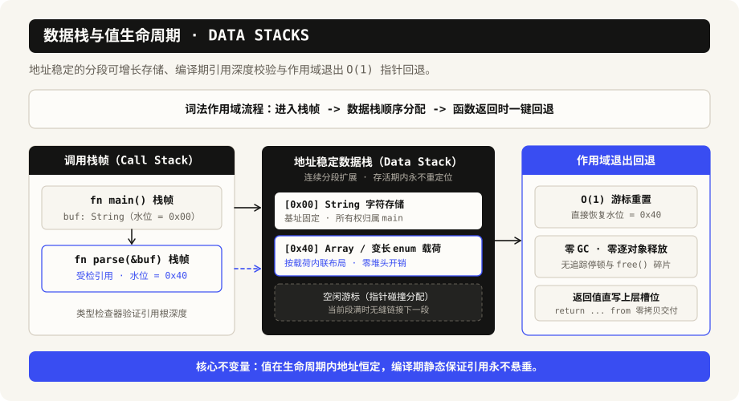](../diagrams/svg/zh/data-stacks-memory.svg)

K 不使用追踪式垃圾回收（GC），也不依赖通用堆分配器。诸如 `String`、`Array` 以及按载荷分布的变长 `enum` 都存放在**地址稳定、分段扩展的数据栈**上：内层作用域传入引用时由类型检查器校验根深度，退出作用域只需 `O(1)` 重置游标即可整体回收。详见 [K 语言架构设计](architecture.md#从资源出发) 与 [运行时实现](implementation.md#7-the-runtime)。

### 编译优化与边界检查消除（BCE）

[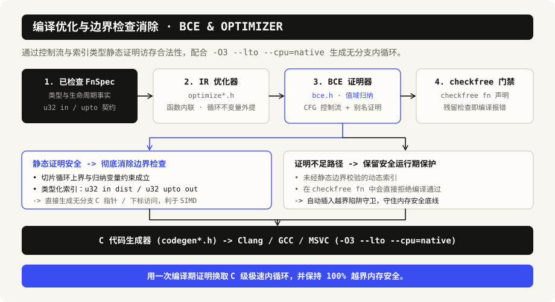](../diagrams/svg/zh/optimization-bce-pipeline.svg)

编译器根据控制流分支、切片范围或索引类型契约（如 `u32 in dist`、`u32 upto out`）在编译期证明索引不越界，进而**完全移除内循环检查代码**。标注 `checkfree fn` 的函数会在编译期充当硬性门禁——只要函数体内残余一条无法证明的越界检查即报错。详见 [边界检查消除实现](implementation.md#5-bounds-check-elimination) 与 [优化器](implementation.md#4-the-optimizer)。

### 结构化异步与隔离工作线程

[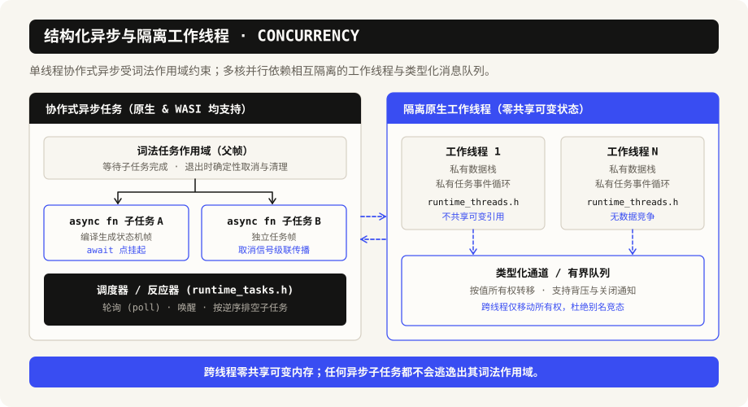](../diagrams/svg/zh/async-tasks-workers.svg)

单线程 `async fn` 会被编译为状态机任务帧（`runtime_tasks.h`），并严格受限于词法任务作用域：父作用域退出前会确定性取消并排空所有子任务。需要多核并行时，K 启动彼此完全隔离的原生工作线程（`runtime_threads.h`），每个线程持有独立数据栈，通过类型化消息队列转移值所有权，从根源上杜绝共享可变状态与数据竞争。详见 [异步函数与装饰器设计](design/async_and_decorators.md)。

### 性能与峰值内存概览

[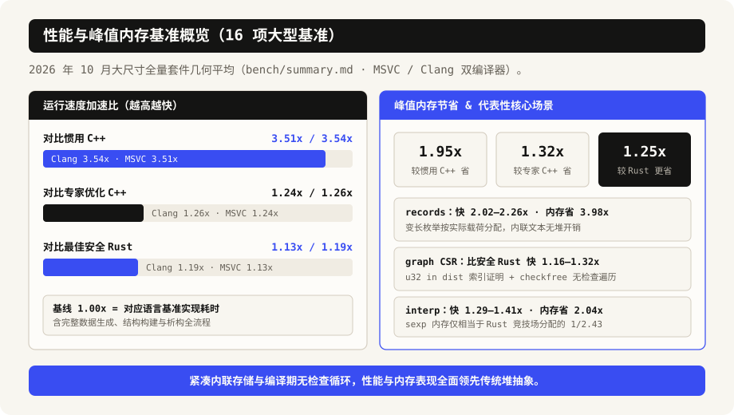](../diagrams/svg/zh/benchmark-architecture.svg)

在 16 项大型工作负载的几何平均对比中，紧凑内联表示与 `checkfree` 无分支循环使 K 在速度上达到惯用 C++ 的 **3.51x / 3.54x**、专家优化 C++ 的 **1.24x / 1.26x**、最佳安全 Rust 的 **1.13x / 1.19x**，同时峰值内存下降 **1.25x–1.95x**。详见 [性能与内存基准总结](bench/summary.md)。

---

## 系统全貌与编译器流水线

### 核心系统架构

[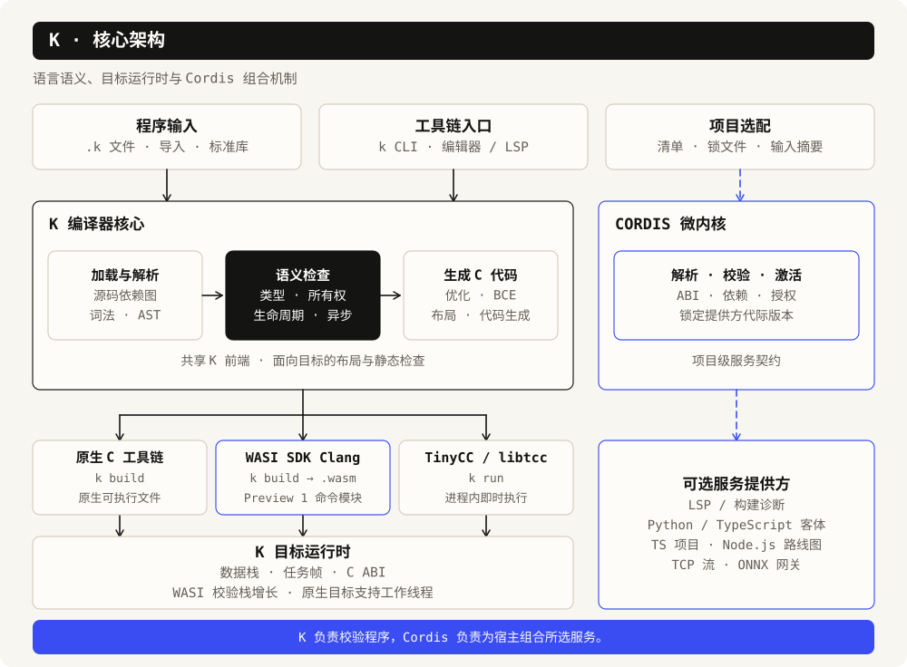](../diagrams/svg/zh/core-architecture.svg)

同一份经过语义与生命周期校验的编译器前端，同时支撑原生 `C + LTO` 构建、`wasm32-wasip1` 模块生成以及开发阶段的进程内 TinyCC 即时执行。参见 [K 语言架构设计](architecture.md)。

### 依赖边界与上下文映射

[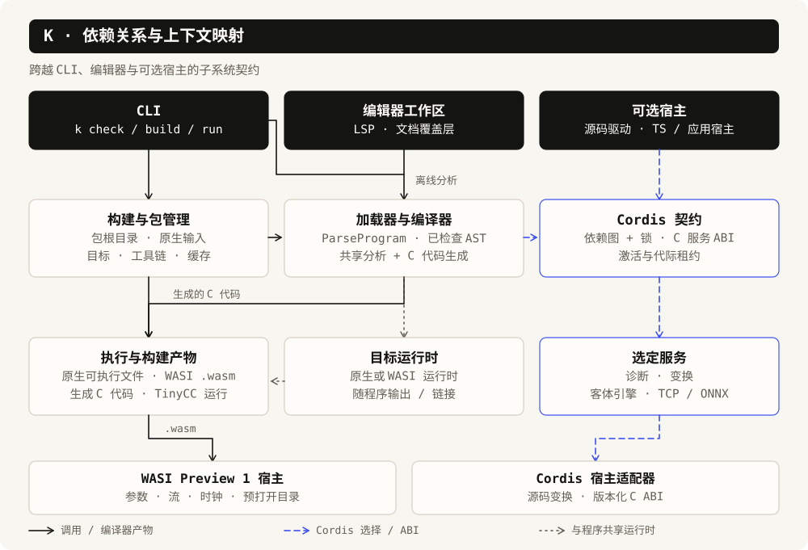](../diagrams/svg/zh/context-map.svg)

K 将程序加载、包解析、语言语义、目标构建与编辑器覆盖缓冲划分为明确的限界上下文。参见 [代码中的领域边界](architecture.md#代码中的领域边界)。

### 编译器前端 · 语义分析 · C 后端

[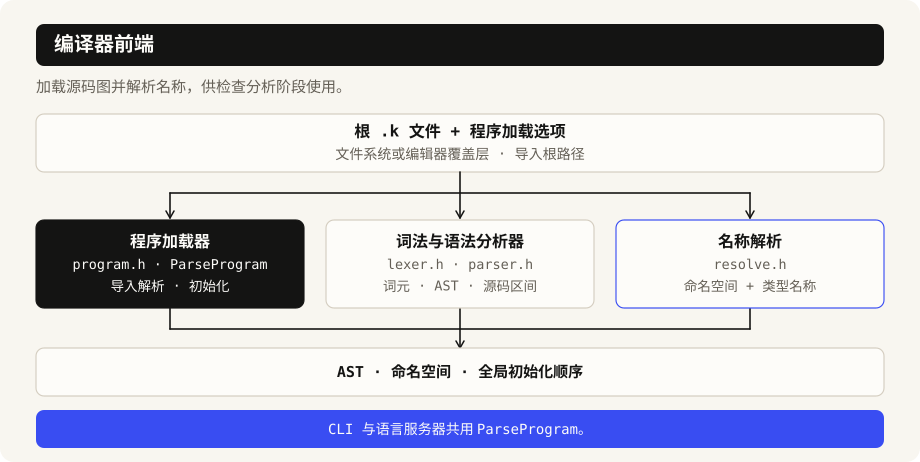](../diagrams/svg/zh/compiler-front-end.svg)

[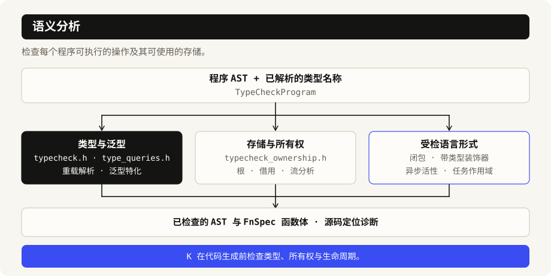](../diagrams/svg/zh/semantic-analysis.svg)

[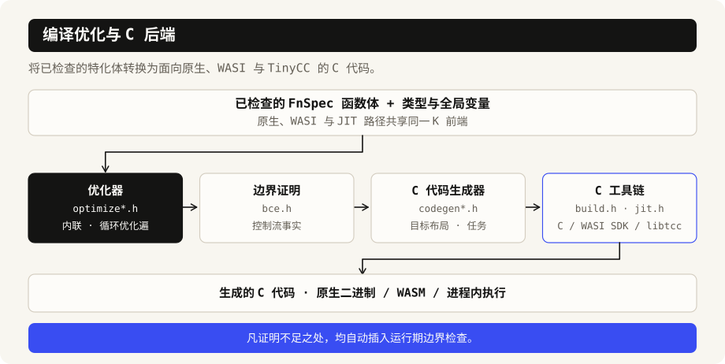](../diagrams/svg/zh/c-backend.svg)

命令行工具 `k` 与语言服务器 `k lsp` 共用同一前端解析入口 `ParseProgram`，并保留完整源码区间以输出精准诊断。参见 [前端实现](implementation.md#2-front-end) 与 [类型检查器](implementation.md#3-the-typechecker)。

---

## 运行时、编译目标与工具链

### 目标运行时与 WebAssembly

[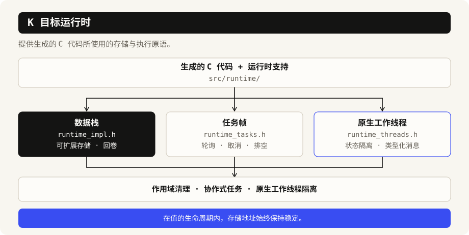](../diagrams/svg/zh/target-runtime.svg)

[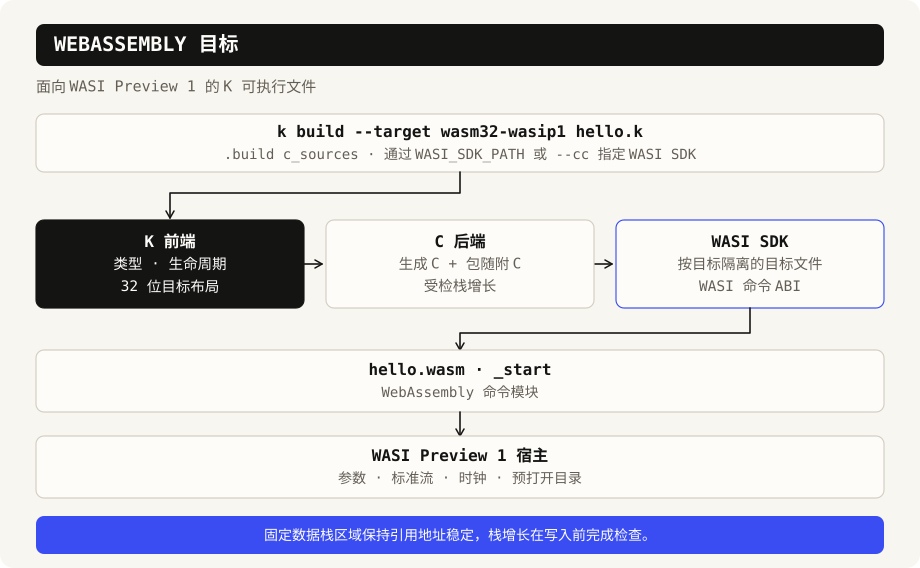](../diagrams/svg/zh/webassembly-target.svg)

执行 `k build --target wasm32-wasip1` 可构建自带 K 运行时的 `.wasm` 命令模块，在 32 位线性内存中维持地址稳定的数据栈分片。参见 [WebAssembly 目标设计](design/wasm.md#wasi-command-target)。

### C ABI 互操作 · 工具链 · 语言服务器 · 标准库

[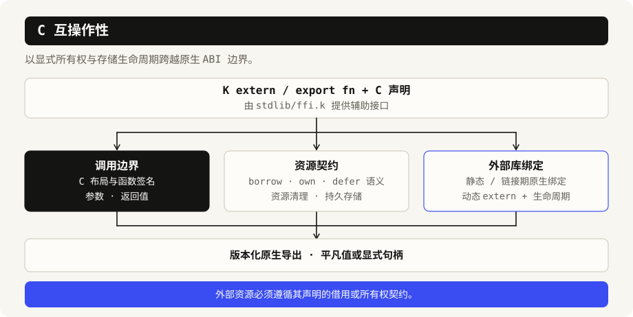](../diagrams/svg/zh/c-interop.svg)

[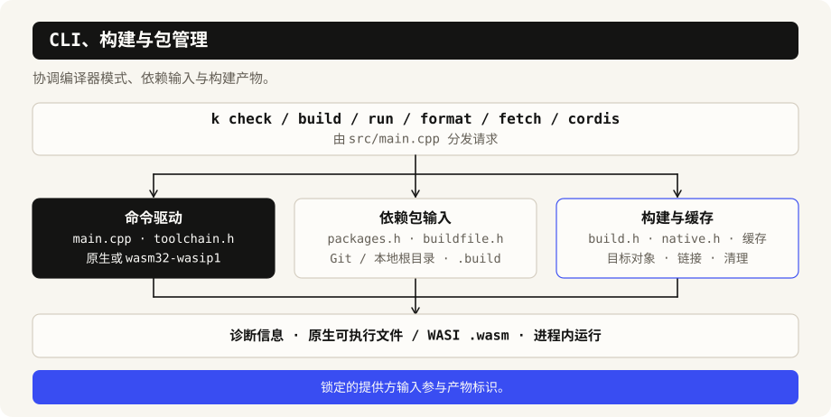](../diagrams/svg/zh/toolchain.svg)

[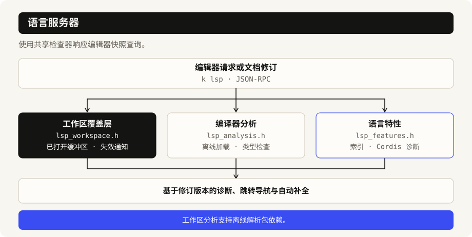](../diagrams/svg/zh/language-server.svg)

[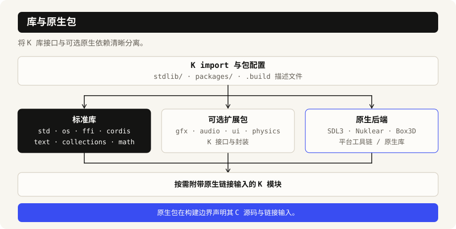](../diagrams/svg/zh/libraries.svg)

通过 `extern` 与 `export fn` 显式区分借用句柄与拥有句柄；工具链按目标和工具链三元组隔离包缓存。参见 [C 句柄所有权](reference.md#owning-c-handles)、[命令行工具](command_line.md)、[包管理](packages.md) 与 [编辑器集成](editors.md)。

---

## Cordis 微内核与宿主服务扩展

[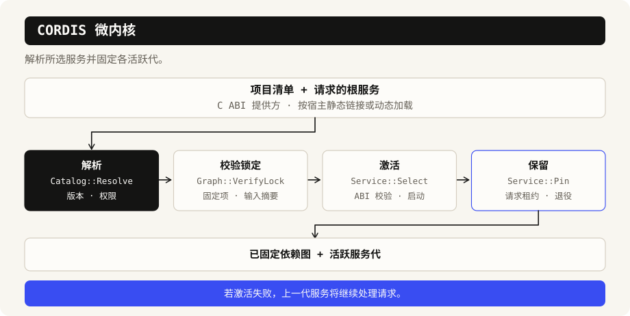](../diagrams/svg/zh/cordis.svg)

[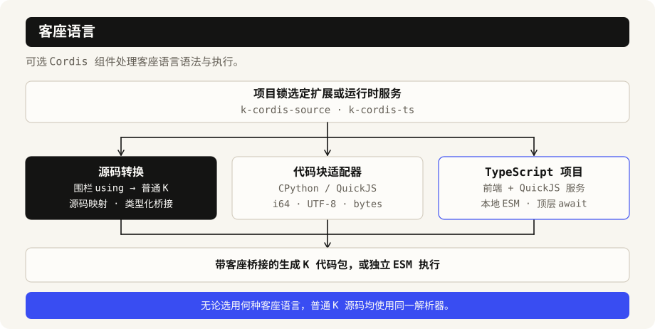](../diagrams/svg/zh/guest-languages.svg)

宿主从受验证锁文件加载版本化服务提供者；替换新版本前先完成 ABI 校验与预激活，确保正在进行的请求和异步外设回调安全完成。参见 [Cordis 微内核设计](design/cordis_microkernel.md) 与 [嵌入式语言设计](design/embedded_languages.md)。
